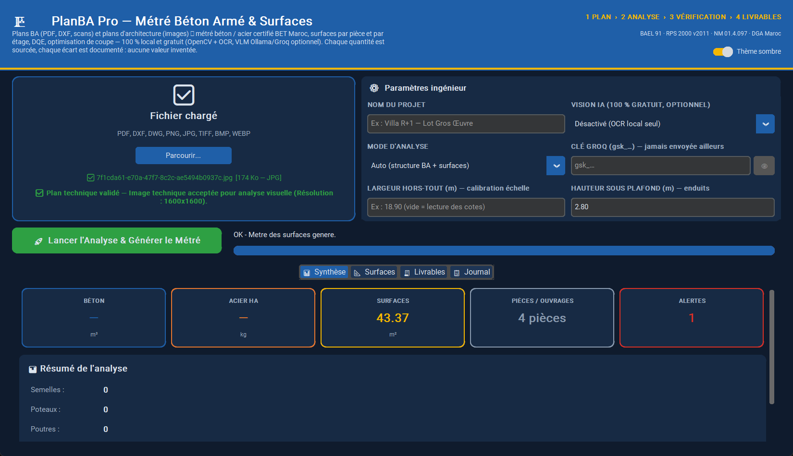

  

<h1 align="center">PlanBA Pro — Métré Béton Armé & Surfaces</h1>

  Déposez un plan, récupérez le métré. 100 % sur votre ordinateur, sans connexion, sans abonnement. 
  <b>Aucune valeur inventée : chaque chiffre vient du plan, chaque doute est signalé.</b>

  📘 Ce guide est pour <b>tout le monde</b> (chef de chantier, métreur, technicien, conducteur de travaux). 
  🧮 Vous êtes ingénieur ou développeur ? Lisez <a href="README_INGENIEUR.md"><b>README_INGENIEUR.md</b></a> (formules, modules, technologies).

---

## 1. À quoi ça sert ?

Vous avez un plan et vous devez chiffrer. PlanBA Pro lit le plan et produit les tableaux Excel prêts à l'emploi :

| Vous avez… | PlanBA Pro vous donne… |
|---|---|
| Un **plan de béton armé** (fondations, poteaux, poutres, coffrage, ferraillage) en PDF, AutoCAD ou scanné | Le **métré béton (m³)**, la **nomenclature acier (kg)**, le **bordereau des prix (DQE)** en dirhams, le **plan de coupe des barres de 12 m**, un **rapport d'audit PDF** |
| Un **plan d'architecture** (pièces, cotes) en image ou PDF | La **surface de chaque pièce (m²)**, le **total par étage**, le **total général**, les **périmètres**, et les lots **second œuvre** (carrelage, plinthes, enduit, peinture, plafond) |

Tout est calculé selon les règles marocaines : **BAEL 91**, **RPS 2000 v2011**, **NM 01.4.097**, **DGA / CPS**.

---

## 2. Installation (2 minutes)

1. Copiez le dossier **`PlanBA_Metre_Extractor`** (fourni en `.zip`) sur votre PC, par exemple dans `C:\PlanBA_App\`.
   *Copiez tout le dossier, pas seulement le fichier `.exe`.*
2. Double-cliquez sur **`PlanBA_Metre_Extractor.exe`**.
3. Un raccourci **« PlanBA Pro »** peut être placé sur le Bureau : clic droit sur le `.exe` → *Envoyer vers* → *Bureau (créer un raccourci)*.

> Pas besoin d'installer Python, ni Excel pour générer les fichiers (Excel ou LibreOffice sert seulement à les ouvrir).
> Aucune donnée ne quitte votre ordinateur. Pas de clé, pas de compte, pas d'abonnement.

---

## 3. Utilisation pas à pas

### Étape 1 — Charger le plan
Cliquez sur **Parcourir…** (ou glissez le fichier dans la zone bleue).
Formats acceptés : `PDF`, `DXF`, `DWG`, `PNG`, `JPG`, `TIFF`, `BMP`, `WEBP`.

### Étape 2 — Paramètres (facultatif)
| Champ | Quand le remplir |
|---|---|
| **Nom du projet** | Pour que le nom apparaisse sur les fichiers Excel. |
| **Mode d'analyse** | Laissez **Auto**. Choisissez *Surfaces uniquement* pour un plan d'architecture, *Structure BA uniquement* pour un plan de ferraillage. |
| **Vision IA (gratuit, optionnel)** | Laissez **Désactivé**. Si vous avez installé *Ollama* sur le PC, ou une clé *Groq* gratuite, l'IA aide à lire les tableaux difficiles. |
| **Largeur hors-tout (m)** | Seulement si le plan d'architecture n'a pas de cotes lisibles, ou si l'application affiche **« ALERTE ÉCHELLE »**. Tapez la largeur réelle du bâtiment (ex. `18.90`). |
| **Hauteur sous plafond (m)** | Pour les enduits et peintures (par défaut `2.80`). |

### Étape 3 — Lancer
Cliquez sur **🚀 Lancer l'Analyse & Générer le Métré**. La barre de progression indique l'étape en cours. Un plan scanné prend 1 à 6 minutes (lecture optique locale).

### Étape 4 — Vérifier
L'application range les résultats dans **4 onglets** (la page ne défile plus dans tous les sens) :

| Onglet | Contenu |
|---|---|
| **📊 Synthèse** | Cartes béton (m³), acier (kg), surfaces (m²), pièces / ouvrages, alertes + récapitulatif des ouvrages |
| **📐 Surfaces** | Tableau **Surfaces par pièce** (étage, cotes, surface, périmètre, **confiance**, observations) |
| **🧾 Livrables** | Boutons d'ouverture des fichiers + **Rapport métier** |
| **📋 Journal** | Tout ce qui a été lu, page par page (traçabilité) |

- Sur les plans BA, une fenêtre **« Corriger les éléments »** s'ouvre : vous pouvez ajuster une dimension lue avant le calcul.
- Le bouton **🔍 Overlay d'audit** ouvre l'image du plan avec les zones lues entourées (vert OK / orange à vérifier / rouge anomalie).

### Étape 5 — Récupérer les fichiers
Onglet **🧾 Livrables** : **📂 Métré BA (Excel)**, **📐 Surfaces (Excel)**, **🔍 Overlay d'audit**, **✏️ Corriger les éléments**, **📁 Dossier de sortie**.
Tous les fichiers sont dans le dossier **`output`** à côté de l'application.

---

## 4. Les fichiers produits

| Fichier | Contenu | Plan BA | Plan archi |
|---|---|:-:|:-:|
| `metre_genere.xlsx` | **Métré BA complet, 10 feuilles** : les 5 feuilles certifiées BET d'abord (avant-métré, nomenclature acier, DQE en MAD, contrôle des ratios, coupe des barres de 12 m) puis les annexes (détail quantitatif, armatures, attachement ferraillage, attachement GO, catalogue des armatures) | ✅ | |
| `metre_certifie_BET.xlsx` | Version « BET » seule (5 feuilles) pour les pages lues par Computer Vision | ✅ (pages scannées / AutoCAD) | |
| `metre_surfaces.xlsx` | Surfaces par pièce et par étage, second œuvre, audit de l'échelle | | ✅ |
| `optimisation_chantiers.xlsx` | Nombre de barres de 12 m à commander, chutes | ✅ | |
| `rapport_metre.pdf` / `note_calculs_chantier.pdf` | Rapport d'audit et note de calculs | ✅ | |
| `audit_overlays/*.png` | Le plan avec les zones lues entourées | ✅ | ✅ |
| `plan_data.json` | Toutes les données brutes lues (preuve) | ✅ | ✅ |

Dans les fichiers Excel, **les totaux sont des formules** : si vous corrigez une dimension, tout se recalcule.

---

## 5. Comprendre les messages

| Message | Signification | Que faire |
|---|---|---|
| ✅ *CONFORME BET MAROC* | Le ratio acier/béton est dans la plage habituelle | Rien |
| ⚠ *ALERTE HORS PLAGE RPS 2011* | Trop ou trop peu d'acier pour ce volume | Vérifier une cote (cm lu en m ?) ou une barre oubliée |
| 🔴 *INVALID_DIAMETER_OCR* (ex. HA18) | Diamètre inexistant au Maroc, lecture douteuse | L'application propose le diamètre voisin (HA16) ; confirmer sur le plan |
| 🔴 *CROSS_CHECK_QTY_MISMATCH* | Le plan de coffrage et le tableau de ferraillage n'ont pas le même nombre d'éléments | Compter sur le plan |
| ⚠ *[ALERTE ÉCHELLE] cotes contradictoires* | Les cotes du plan d'architecture ne sont pas cohérentes entre elles | Saisir la **largeur hors-tout** réelle et relancer |
| *Surface NON TROUVÉE* | Ni cote `L x l`, ni échelle fiable pour cette pièce | Saisir la largeur hors-tout, ou mesurer la pièce |
| *Zone ouverte partagée* | Cuisine / séjour / salle à manger sans cloison : comptés une seule fois dans la ligne « ZONE OUVERTE » | Normal |

**Règle d'or :** l'application préfère écrire *NON TROUVÉ* plutôt que d'inventer un chiffre.

---

## 6. Questions fréquentes

**Le plan est scanné / photographié, ça marche ?**
Oui. La lecture optique est intégrée (hors-ligne). Prenez une image nette, droite, d'au moins 1600 px de large.

**Mon PDF AutoCAD donne « 0 mot lu ».**
C'est un PDF avec textes « explosés » (polices SHX). PlanBA Pro le détecte et bascule automatiquement en lecture visuelle.

**Les surfaces semblent fausses.**
Regardez l'overlay d'audit et la colonne *Confiance*. Si une **ALERTE ÉCHELLE** est affichée, saisissez la largeur hors-tout réelle. Les cotes écrites sur le plan (`4.20 x 3.50`) sont toujours prioritaires sur la mesure automatique.

**Ça tourne sans Internet ?**
Oui, entièrement. L'option *Vision IA* est facultative et gratuite (Ollama local ou Groq Free Tier).

**Où sont mes fichiers ?**
Dans le dossier `output` à côté de `PlanBA_Metre_Extractor.exe` (bouton **📁 Dossier de sortie**).

---

## 7. Support

- Problème ou idée : ouvrez une *issue* sur GitHub → <https://github.com/Youssef-AMARZOU/metre-ba-agent/issues>
- Documentation technique complète : [README_INGENIEUR.md](README_INGENIEUR.md)
- Licence : voir [LICENSE](LICENSE)
